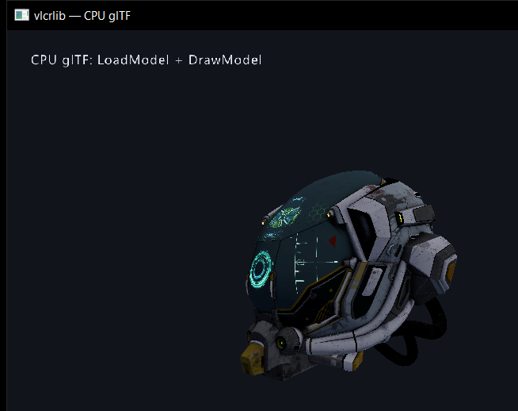
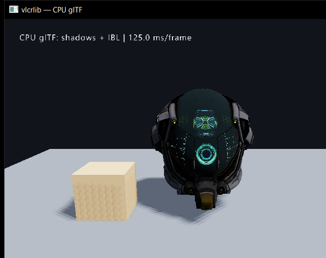
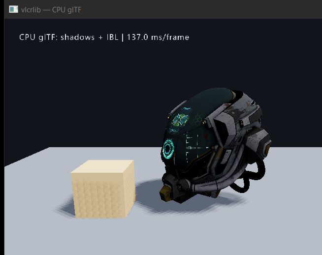

# CPU backend milestone

A CPU backend is a software renderer, not a flag on Vulkan/WebGPU. It must own
the framebuffer and implement the public drawing API.

## MVP status

Implemented in `src/vcpu.c` / `src/vcpu.h`:

- RGBA8 color + float depth buffers;
- 2D triangle/line rasterization;
- 3D triangle projection with z-buffer and perspective divide;
- near-plane clipping in clip space (`z >= 0`);
- perspective-correct UV interpolation;
- texture sampling (`VCpuTextureFromImage`);
- 2D batch (`VCpuBatchBegin/PushRect/Flush`) with per-vertex colors;
- scissor (`VCpuSetScissor`/`VCpuResetScissor`);
- `VCpuModelCreate` + `VCpuDrawModel` (unlit, for compatibility);
- `vgraphics_BuildCpuModel(Model, ...)` bridge: bakes GPU model node transforms
  and copies geometry, normals, vertex colours, per-primitive materials and
  albedo/emissive textures;
- `VCpuDrawModelShaded` + `VCpuSetDirectionalLight`/`VCpuSetAmbientLight`:
  bilinear sampling, sRGB decode, GGX-style lighting, ACES tone mapping;
- CPU directional shadow map (`VCpuShadowBuild`) with PCF and a one-frame caster
  list;
- CPU IBL from `VIBL_Bundle` (irradiance, prefiltered specular, BRDF LUT);
- per-model CPU cache in `vcore.c`, invalidated on unload/material changes;
- alpha blending/masking;
- nearest-neighbour `VCpuBlit`;
- backend preference (`VCpuSetPreferredBackend`) and public backend selector
  (`VRenderBackendSelect/Get/Name/Available`);
- deterministic FNV hash (`VCpuHash`) and PPM screenshot (`VCpuSavePPM`);
- SDL presentation demo: `example/cpu_raster_example.c`;
- unit tests: `tests/test_cpu_raster.c` and `tests/test_cpu_gltf.c`.

The 2D path is transparent now:

```c
VRenderBackendSelect(VRENDER_BACKEND_CPU);
InitWindow(800, 600, "cpu");
BeginDrawing();
ClearBackground(...);
DrawRectangle(...);
DrawText(...);
EndDrawing();
```

`InitWindow` creates an SDL window + streaming texture instead of a Vulkan
swapchain. `vgraphics_DrawVertexBuffer` dispatches to `VCpuBatch`, and loaded
textures get a CPU RGBA8 sidecar, so text works too. See
[example/cpu_2d_example.c](../example/cpu_2d_example.c) and
[docs/cpu_2d_example.png](cpu_2d_example.png).

3D `GenMesh*` + `DrawModel` also go through CPU now:

```c
Mesh cube = GenMeshCube(2, 2, 2);
Model model = LoadModelFromMesh(cube);
BeginMode3D(cam);
DrawModel(model, position, rotation, scale, tint);
EndMode3D();
```

`registerMesh` keeps a CPU vertex/index copy when no Vulkan device exists,
`vgraphics_BuildCpuModel` flattens it, and `DrawModel` dispatches to
`vcore_CpuDrawModel`. See [example/cpu_3d_example.c](../example/cpu_3d_example.c)
and [docs/cpu_3d_example.png](cpu_3d_example.png).

### CPU glTF / PBR materials (Phase 1, 2026-10-28)

`LoadModel("model.glb")` now produces a textured, lit CPU model without a Vulkan
device:

- `vgraphics_BuildCpuModel()` builds one `VCpuModelPart` per glTF primitive,
  with base-colour factor, metallic/roughness, emission, alpha mode/cutoff,
  double-sided flag and copied albedo + emissive textures from the CPU sidecar.
- `VCpuVertex` carries world-space normals and vertex colours; zero normals fall
  back to the geometric normal.
- `VCpuDrawModelShaded()` does bilinear texture sampling, sRGB decode, a
  directional + ambient GGX/Blinn-style response, ACES tone mapping and sRGB
  output. `vgraphics_SetDirectionalLight/SetAmbientLight/SetGraphicsExposure`
  feed the CPU light state.
- `LoadMaterialDefault()` and `SetMaterialTexture()` work without a device; a
  material slot with no descriptor set is valid in CPU mode.
- CPU textures are packed as `0xAARRGGBB` (the previous raw-RGBA memcpy produced
  red/blue swaps) and texture slot allocation now considers `cpuPixels`, so
  glTF textures no longer share slot 1 and get overwritten by the font atlas.
- The per-model `VCpuModel` is cached and invalidated by `UnloadModel()` and by
  material changes, instead of being rebuilt on every draw.

`tests/test_cpu_gltf.c` loads `assets/DamagedHelmet.glb`, verifies geometry,
parts, textures and normals, renders offscreen and checks for coloured pixels.



Limits: this covers static glTF/mesh geometry, materials and textures.
Normal/roughness/AO map sampling, transparency sorting, skinning and
post-process are not part of the CPU 3D path yet. Measured `DrawModel` cost for
DamagedHelmet at 640x480 is roughly 40-57 ms/frame on the test machine; the
shaded rasterizer is still single-threaded.

### CPU shadows + IBL (Phase 2, 2026-10-28)

Directional shadows and image-based lighting are now wired into the CPU path:

- `vgraphics_SetShadows()` and `vgraphics_SetShadowSoftness()` call the CPU
  implementations. The map defaults to 512² (up to 1024²), with constant +
  slope-scaled bias and PCF (1–3 texel radius).
- `VCpuShadowBuild()` fits an orthographic light frustum around the casters,
  rasterizes a depth-only map and keeps it for sampling.
- Because the immediate-mode API has no scene graph, casters are recorded during
  `DrawModel()` and the map is rebuilt at the next `BeginDrawing()` (one frame of
  latency). Up to 64 casters are recorded.
- `vgraphics_LoadIBL()` builds the existing `VIBL_Bundle` and, on the CPU path,
  moves it into the CPU renderer instead of uploading to Vulkan.
  `vgraphics_SetIBLIntensity()`, `vgraphics_IsIBLLoaded()` and
  `vgraphics_UnloadIBL()` are CPU-aware.
- Shading samples the irradiance cube for diffuse, the prefiltered cube for
  specular and the BRDF LUT for the split-sum approximation. `vgraphics_LoadIBL(
  NULL)` gives a procedural studio environment; an `.hdr` path works too.
- `tests/test_cpu_gltf.c` now also checks that enabling shadows and IBL changes
  the rendered image.



Limits: one directional cascade (no CSM), no point/spot shadows and no skybox
rendering. The current example uses a 256² map, a 3×3 PCF kernel and a modest
IBL intensity so the shadow remains visible. Measured at 640×480 on the test
machine: about **125 ms/frame** with shadows + IBL (~8 fps), versus 40-57 ms for
the same model without them. The CPU path is still single-threaded; shadow
sampling and IBL are the next optimization targets.

## WebAssembly fallback

The same `VCpuCanvas` is compiled to a standalone wasm module:

```text
web/vcpu_web.c       software graph: shadow → ground/CSM → scene → SSAO → bloom → TAA
web/vcpu_web.wasm    generated by `vcpu_wasm` (Emscripten 3.1.58)
web/vcpu.html        inline JS; no generated JS glue file
```

The passes are CPU approximations:

- SSAO from the depth buffer, 8 taps;
- bright-pass + 5×5 box blur bloom;
- TAA history blend (motion ghosting is visible with moving geometry);
- four-bone hierarchical skinned tube: every vertex has four weights
  (`w0 + w1 + w2 + w3 = 1`), each bone pivots around its parent joint;
- two-cascade CSM:
  - 2 × 512² software depth shadow maps;
  - light-space orthographic matrices with extents 3.5 and 8;
  - ground plane reconstructed with a full 4×4 inverse;
  - 3×3 PCF and cascade selection by distance.

See [docs/cpu_wasm_skinning.png](cpu_wasm_skinning.png) and
[docs/cpu_wasm_csm.png](cpu_wasm_csm.png).

This is **not** WebGPU and not a GPU render graph.

Build:

```bash
emcmake cmake -S . -B build-web -G Ninja \
  -DCMAKE_BUILD_TYPE=Release -DVLCRLIB_SKIP_VCPKG=ON
cmake --build build-web --target vcpu_wasm
python -m http.server 8103 --directory web
# open http://127.0.0.1:8103/vcpu.html
```

The demo was validated in headless Chrome; see
[docs/cpu_wasm_demo.png](cpu_wasm_demo.png). It uses WASM's `memory` directly
and copies `0xAARRGGBB` to an `ImageData` RGBA buffer.

This is a **CPU software-rendering fallback in the browser**, not a transparent
engine switch and not WebGPU.

## CPU-only build (no Vulkan at all)

`VLCRLIB_GRAPHICS_CPU=ON` selects `src/vgraphics_cpu.c` and a minimal source
list: no Vulkan backend files (`vgraphics.c`, `vgraphics_device.c`, ...), no
`vrender_graph.c`, no Vulkan/WebGPU link, no physics or asset tools. Configure
against a native SDL3 (the sample below uses the workspace vcpkg install):

```powershell
cmake -S . -B build-cpu -G "Visual Studio 18 2026" -A x64 `
  -DVLCRLIB_GRAPHICS_CPU=ON -DVLCRLIB_BUILD_TOOLS=OFF `
  "-DCMAKE_PREFIX_PATH=$PWD/vcpkg_installed/x64-windows" `
  "-DSDL3_DIR=$PWD/vcpkg_installed/x64-windows/share/sdl3"
cmake --build build-cpu --config Release --target cpu_gltf_example test_cpu_gltf
```

Verified with `dumpbin /dependents`:

```text
SDL3.dll, KERNEL32.dll, MSVCP140.dll, VCRUNTIME140*.dll, api-ms-win-crt-*.dll
```

There is **no `vulkan-1.dll` import**. `test_cpu_gltf` passes all 19 checks in
this build, including shadows and IBL. `cpu_gltf_example` renders the same
textured/shadowed/IBL scene:



`vgraphics_cpu.c` owns CPU-side texture, material, mesh and model tables plus
the glTF bridge (`LoadModel`, `vgraphics_RegisterMesh`,
`vgraphics_CreateModelFromMeshesEx`, `vgraphics_BuildCpuModel`). This is separate
from the Vulkan build's asset tables, so future asset-format work must update
both (a shared asset layer is the cleaner long-term refactor).

The minimal target ships **glTF/GLB** loading. OBJ/FBX/USD/cooked loaders and
`LoadModelAuto` are excluded; those remain part of the Vulkan/asset-tool build.

## Remaining engine integration

Completed in Phase 0/1:

1. **Presentation** — SDL streaming texture, ARGB8888 canvas, canvas
   reallocation on window/DPI resize.
2. **2D** — vertex batch, solid/textured triangles, scissor and blending.
3. **3D** — CPU transform, near-plane clipping, z-buffer, perspective-correct
   UVs, `T * R * S` model transform.
4. **Materials** — base colour, albedo/emissive textures, normals,
   directional/ambient shading, ACES tone mapping; normal mapping still
   optional/not sampled.
5. **Meshes/models** — the same `Mesh`/`Model` tables, `LoadModel`/`DrawModel`,
   shape helpers and a per-model CPU cache.

Still remaining:

6. **Optional CPU-only SDL renderer** — `SDL_CreateRenderer(window, NULL)` may
   still select a GPU-accelerated SDL backend even in the CPU-only build.
7. **Shared CPU asset layer** — `vgraphics_cpu.c` duplicates the texture /
   material / mesh table logic from the Vulkan build; unify it when the asset
   pipeline stabilizes.
8. **Performance** — the shaded path is single-threaded; tiled threading and
   backface culling are the next optimizations.

## Not in the current milestone

- SSAO/bloom/TAA/FXAA;
- CSM, point/spot shadows;
- normal/MR/AO map sampling and transparency sorting;
- skinning and morph targets;
- ray tracing and GPU timers.

## Acceptance

- `api_smoke` 2D/3D path with CPU backend;
- deterministic screenshot;
- no Vulkan dependency: the `VLCRLIB_GRAPHICS_CPU` executable imports only
  SDL3/CRT DLLs (SDL's presentation renderer may still use a GPU API);
- 30 fps at 640x360 for the smoke scene — not yet met: DamagedHelmet is
  roughly 40-57 ms per `DrawModel` at 640x480 without shadows/IBL, about
  125 ms in the Vulkan-linked CPU mode and 137 ms in the CPU-only build with a
  256² shadow map + 3×3 PCF + procedural IBL on the test machine.

## Estimate

This is a multi-thousand-line rasterizer plus API surface. The CPU-only
configuration now builds the same `vlcrlib` target without Vulkan; splitting
the duplicated CPU asset tables into a dedicated `vlcrlib_cpu` target remains a
future cleanup.
