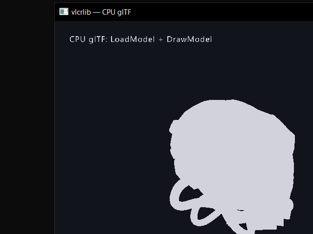

# CPU / WebGPU gap audit

Date: 2026-10-28  
Scope: CPU glTF loading, CPU materials/textures, CPU shadows/IBL, WebGPU parity
and real-runtime validation.  
Method: source review, existing build artifacts, `ctest`, and a live CPU-backend
run of `example/cpu_gltf_example.c` with `assets/DamagedHelmet.glb`.

This is a status audit, not a claim that the four milestones are complete. The
short version:

> **Implementation update (2026-10-28):** Phase 0 + Phase 1 + Phase 2 landed
> after this audit. CPU glTF now has per-material parts, albedo/emissive
> textures, normals, directional/ambient shading, ACES tone mapping, a cached
> `VCpuModel`, a directional shadow map with PCF, and IBL from `VIBL_Bundle`
> (irradiance + prefiltered specular + BRDF LUT). Sections 1-3 below document the
> pre-change state; see [CPU_BACKEND.md](CPU_BACKEND.md) for the current status.
> WebGPU P0 (dynamic UBO ring, vertex arena, error callback, link-compatible
> feature stubs) plus a headless validation example/runner
> ([WEBGPU_RUNTIME.md](WEBGPU_RUNTIME.md)) also landed and passed 150 frames
> with zero uncaptured errors; see
> [WEBGPU_PARITY.md](WEBGPU_PARITY.md). A true
> GPU-free target (`VLCRLIB_GRAPHICS_CPU=ON`) now builds and passes
> `test_cpu_gltf` without `vulkan-1.dll`; full WebGPU parity and CPU skinning
> remain open.

| Milestone | Status | Verdict |
|---|---|---|
| CPU glTF loader (`LoadModel("model.glb")` without a GPU device) | **Implemented (static, CPU-only target)** | Geometry, materials, textures, shadows and IBL work. `VLCRLIB_GRAPHICS_CPU=ON` builds without Vulkan; `cpu_gltf_example.exe` has no `vulkan-1.dll` import. Skinning is still absent. |
| CPU materials/textures | **Implemented (basic PBR)** | Per-part base colour, metallic/roughness, emission, alpha mode, albedo + emissive textures, normals, bilinear sampling and shading. No normal/MR/AO map sampling yet. |
| CPU shadows/IBL | **Implemented (directional + IBL)** | 512² PCF directional shadow map, one-frame caster list, irradiance/prefiltered/BRDF IBL. No CSM, point/spot shadows or skybox yet. |
| WebGPU full parity on a real runtime | **Prototype + P0/P1, smoke-validated, far from parity** | Forward PBR + 2D + FXAA + TAA + bloom + SSAO + offscreen composite + 4-cascade shadows + spot shadow + point lights (one cube shadow) + skinned glTF/animation + IBL + frame stats/GPU timestamps + screenshots. A 150-frame Chrome 156 headless run (`--use-angle=d3d11`) with FXAA/TAA/bloom/SSAO/shadow/IBL toggles and one skinned draw reports `errors=0` and renders the multi-object scene. Still no render graph. |

---

## 1. CPU glTF loader

### What already works

`LoadModel()` dispatches `.glb`/`.gltf` to `LoadModelGLTFTiny()` **before** the
`!VK.device` check:

- `src/vgraphics.c:2589-2598`
- `src/vgltf.cpp:530-567`

`vgraphics_RegisterMesh()` has a CPU-only branch that stores `cpuVertices` and
`cpuIndices` when `VK.device == NULL`:

- `src/vgraphics.c:1447-1483`

`vgraphics_CreateModelFromMeshesEx()` does not require a device, so the model
handle is created and `vgraphics_BuildCpuModel()` can flatten the geometry:

- `src/vgraphics.c:7961-8008`
- `src/vgraphics.c:2519-2567`

Live probe:

```powershell
build-check\example\Release\cpu_gltf_example.exe assets\DamagedHelmet.glb
```

The process stayed alive in its render loop for the 5 s probe and printed no
`LoadModel failed` error. A window capture showed the helmet silhouette on the
CPU canvas:



So the minimal claim "`LoadModel("model.glb")` returns a model and `DrawModel`
puts triangles on screen without a Vulkan device" is **true today**. The
material/texture/lighting claim is not.

### Why it still looks wrong

The capture is a flat, untextured, unlit silhouette. The reason is not the glTF
parser; it is the CPU bridge:

1. `vgraphics_BuildCpuModel()` copies positions and UVs only. It ignores
   `ModelEntry.materials`, `ModelEntry.meshMaterials`, `Vertex3D` normals,
   tangents and vertex colours, and every `Texture2D`:
   `src/vgraphics.c:2544-2557`.
2. `VCpuVertex` is `{ position, uv }` and `VCpuModel` has one `baseColor` and one
   `texture` for the whole model:
   `src/vcpu.h:37-49`.
3. `makeMaterial()` calls `LoadMaterialDefault()`, which returns `{0}` when
   `VK.device == NULL`:
   `src/vgraphics_material.c:454-456`.
4. `SetMaterialTexture()` rejects a texture whose `g_textureTable[id].view` is
   null. CPU textures only have `cpuPixels`:
   `src/vgraphics_material.c:531-538`,
   `src/vgraphics.c:1196-1234`.
5. `material_handle_valid()` requires a Vulkan descriptor set:
   `src/vgraphics_material.c:30-35`.

The loader still decodes and uploads every glTF texture to the CPU sidecar, then
tracks it on the model (`src/vgltf.cpp:296-311`, `src/vgraphics.c:2601-2610`),
but no CPU draw path ever samples it. That is wasted memory and load time.

### Related loader gaps

- `LoadModel()` for non-glTF falls back to OBJ only when `VK.device` exists:
  `src/vgraphics.c:2595-2597`. So `.obj` does **not** load on the CPU path,
  despite the generic name `LoadModel`.
- `LoadModelAuto()` routes `.fbx`, `.usd`, `.obj` and `.vmesh` to loaders that
  were written around the GPU mesh table: `src/vloaders.c:7-29`.
- Skinned glTF is only handled by `vgltf_LoadSkinnedModel()` and
  `LoadSkinnedModel()`, which use the GPU skin pipeline. The CPU backend has no
  skinning path.

### "Without GPU" is not literally true yet

> **Resolved:** `VLCRLIB_GRAPHICS_CPU=ON` now builds a Vulkan-free target; the
> notes below describe the pre-change runtime-only CPU mode.

The CPU backend is a runtime mode inside a Vulkan-linked build:

- `CMakeLists.txt:255-260` compiles `vgraphics.c` (Vulkan) for desktop.
- `CMakeLists.txt:383-385` links `Vulkan::Vulkan`.
- There is no `VLCRLIB_GRAPHICS_CPU` CMake option, although
  `docs/CPU_BACKEND.md:131-134` lists it as remaining work.

A dependency check of the built CPU example confirms:

```text
SDL3.dll
vulkan-1.dll
...
```

So on a machine with no Vulkan loader, the executable can fail before
`InitWindow()` even though the chosen renderer is the CPU canvas. A true
GPU-free target needs a separate build that excludes `vgraphics*.c`, Vulkan
headers and `Vulkan::Vulkan`.

Also, presentation uses a default SDL renderer
(`src/vcore.c:100-105`), which may select a GPU-accelerated SDL backend. For a
strict software path, create a software renderer/surface explicitly.

### CPU draw-path correctness and cost

- `vcore_CpuDrawModel()` calls `vgraphics_BuildCpuModel()` on **every**
  `DrawModel()` call, allocating and copying the whole model each frame:
  `src/vcore.c:162-191`.
- The model transform is built as `S * R * T`:

  ```c
  world = MatrixMultiply(MatrixScale(...),
              MatrixMultiply(MatrixRotateZ(...),
              MatrixMultiply(MatrixRotateY(...), MatrixRotateX(...))));
  world = MatrixMultiply(world, MatrixTranslate(position...));
  ```

  `src/vcore.c:183-188`

  With column-vector math this applies translation before rotation/scale. The
  GPU path uses the conventional `T * R * S`
  (`src/vgraphics.c:2726-2729`). For a rotated/scaled object away from the
  origin the CPU placement differs from the GPU placement.
- There is no CPU frustum culling: `DrawModel()` returns into
  `vcore_CpuDrawModel()` before the GPU culling code.
- `VCpuDrawModel()` rasterizes every triangle double-sided; no backface culling
  (`src/vcpu.c:454-478`).
- `VCpuTriangle3D()` (public helper) has no near clipping and no
  perspective-correct UVs, unlike `VCpuDrawModel()`; it is a separate, simpler
  path (`src/vcpu.c:158-205`).
- Framebuffer resize only stretches: the CPU canvas is allocated at
  `InitWindow()` size and is not reallocated by `vgraphics_Resize()`
  (`src/vcore.c:99-118`, `src/vcore.c:244-248`).

---

## 2. CPU materials / textures

### Missing pieces

A CPU material path needs four things that do not exist today:

1. **A device-independent material record.**
   `Material` itself is mostly plain data, but allocation and validity are tied
   to `PBRMaterialEntry` / `VkDescriptorSet`. `LoadMaterialDefault()` must
   allocate a CPU slot when `VK.device == NULL`; `material_handle_valid()` must
   accept a slot with `descSet == VK_NULL_HANDLE` and a live CPU record.
2. **Texture validity that accepts `cpuPixels`.**
   `SetMaterialTexture()` currently rejects CPU textures because it checks only
   `view`. It should accept `view || cpuPixels`, and `UnloadTexture()` must
   detach materials before freeing the sidecar.
3. **A CPU vertex format with normals and vertex colours.**
   `VCpuVertex` has only position and UV. Add at least `Vector3 normal` and
   `Color color`; tangents can wait for normal mapping.
4. **A multi-part CPU model.**
   `VCpuModel` has one texture/base colour. A glTF model has one primitive and
   one material per draw slot. Add a part table:

   ```c
   typedef struct VCpuModelPart {
       int firstIndex, indexCount;
       const VCpuTexture *albedo;
       Color baseColorFactor;   /* or float[4] linear */
       float metallic, roughness;
       float emissive[3], emissiveStrength;
       int alphaMode;           /* 0 opaque, 1 mask, 2 blend */
       float alphaCutoff;
       int doubleSided;
   } VCpuModelPart;
   ```

   `VCpuDrawModel()` then loops parts instead of using one texture/base colour.

### Texture sampling

The CPU sampler in `sampleTexture()` is nearest-neighbour with repeat wrapping
only (`src/vcpu.c:353-363`). `TextureOptions` (`srgb`, `minFilter`, `magFilter`,
`wrapS`, `wrapT`, `mipmaps`) are stored/used by the Vulkan sampler but lost on
the CPU side. For glTF parity the CPU path needs at least:

- bilinear filtering;
- clamp / repeat / mirrored-repeat;
- sRGB decode for base colour and emissive;
- an alpha-mask cutoff and a separate blended pass for `BLEND`;
- optional normal-map sampling after tangents exist.

### Suggested implementation order

1. Make materials/textures allocatable without a device (no renderer changes).
2. Extend `VCpuVertex` / `VCpuModel` and `vgraphics_BuildCpuModel()` to carry
   normals, per-part material and albedo texture.
3. Add a cached CPU model per `Model` handle (invalidate on unload/material
   change) instead of rebuilding every frame.
4. Add a CPU shading function: Lambert + GGX approximation + ambient, tone map,
   sRGB encode. A simpler Blinn-Phong first pass is acceptable for the
   milestone.
5. Add tests: a 2x2 albedo texture on a quad, a material with a non-white base
   colour, an alpha-mask texel, and a translated/rotated/scaled model compared
   against the GPU transform convention.

---

## 3. CPU shadows / IBL

> Resolved for the directional + IBL case in Phase 2; the notes below are the
> original gap analysis. CSM, point/spot shadows and skybox remain open.

### Current state

- CPU `DrawModel()` returns before the shadow-caster recording block, so there
  is no CPU scene list for a shadow pass:
  `src/vgraphics.c:2717-2721`.
- `vgraphics_shadow.c` only computes light/view-projection matrices; it does not
  rasterize a depth map.
- There is no CPU light state. `vgraphics_SetDirectionalLight()` and friends
  write the Vulkan `VK` state, which the CPU renderer never reads.
- `vibl.c` is CPU code and can build environment, irradiance, prefiltered and
  BRDF data (`src/vibl.h:15-62`), but `vgraphics_LoadIBL()` immediately uploads
  the bundle to Vulkan and frees it:
  `src/vgraphics.c:4228-4277`.
- In CPU mode the upload path is not guarded for `VK.device == NULL`; it reaches
  `ibl_create_samplers()` / `ibl_create_cube()` and Vulkan calls. A CPU
  `LoadIBL()` call is therefore unsafe, not merely unsupported.

### What a CPU shadow/IBL milestone needs

**Shadows (directional first, then CSM)**

1. Retain a per-frame list of CPU casters (model id, transform, bounds), or use
   the previous frame's list so the shadow pass can run in `BeginDrawing()`
   before scene draws.
2. Add a depth-only software pass:
   - light view/projection from `vgraphics_shadow.c`;
   - reuse a `VCpuCanvas`-like depth buffer (no colour attachment);
   - slope-scaled bias and normal-offset bias;
   - front-face culling or two-sided rendering depending on the asset.
3. Add 3x3 PCF and a cascade selector. Four cascades in a 2x2 atlas matches the
   Vulkan contract (`docs/ARCHITECTURE.md:118-130`).
4. Feed the shadow factor into the CPU shading function.

**IBL**

1. Keep `VIBL_Bundle` alive in CPU mode instead of freeing it after GPU upload.
2. Sample the irradiance cube for diffuse and the prefiltered cube + BRDF LUT
   for specular. A cheap approximation (irradiance only) is a valid first step.
3. Add a procedural fallback so the CPU path has a non-black environment when no
   `.hdr` is supplied.
4. Honour `vgraphics_SetIBLIntensity()` and the existing feature toggles.

**Performance**

A software shadow pass roughly doubles the vertex/raster work. Do not add CSM
before the base path is measured. A 640x360 target at 30 fps is a reasonable
first acceptance gate; the current per-frame `BuildCpuModel` must be removed
before measuring.

---

## 4. WebGPU parity and real runtime

### Size and structure

The WebGPU backend is one ~650-line file:

- `src/vgraphics_webgpu.c` — ~650 lines after the P0/P1 fixes.
- Vulkan backend files — ~10,495 lines total
  (`vgraphics.c`, `vgraphics_device.c`, `vgraphics_pipeline.c`,
  `vgraphics_material.c`, `vgraphics_shadow.c`, `vgraphics_rayquery.c`,
  `vrender_graph.c`).

Line count is not a feature metric, but 4.2% of the renderer code volume matches
the observed feature gap.

### Feature inventory

| Feature | Vulkan | WebGPU |
|---|---|---|
| 2D textured batching | yes | yes |
| glTF static meshes | yes | yes (basic) |
| Compressed KTX2 BC7/BC5/ETC2/ASTC | yes | BC7/BC5 via `texture-compression-bc`; ETC2 RGB8 and ASTC 4x4 code paths via `texture-compression-etc2`/`-astc` (this adapter lacks both; fixtures report id 0) |
| Forward PBR, one directional + ambient | yes | yes |
| Depth buffer | yes | yes |
| Offscreen scene + composite | yes | yes |
| IBL / skybox | yes | IBL implemented (irradiance/prefiltered/BRDF), smoke-validated; skybox still no-op |
| Shadows / CSM | yes | 4-cascade frustum-fit 2048² atlas + adaptive splits + snapping + boundary fade + PCSS (blocker search + variable 5×5 PCF); all four spots with 1024² PCSS maps; all four point lights with 512² cube PCSS in one 24-layer cube array |
| Point lights | yes | up to 4 in PBR, all with cube shadows |
| SSAO | yes | half-res depth-discontinuity AO, smoke-validated and toggleable |
| Bloom | yes | half-res bright/blur + additive composite, smoke-validated and toggleable |
| TAA / velocity | yes | jitter + per-command and skinned velocity buffers + history clamp, smoke-validated |
| FXAA | yes | composite FXAA, smoke-validated and toggleable |
| Skinning / animations | yes | bone palette + skinned PBR/velocity/shadow pipelines, one skinned validation draw |
| Render graph | yes | **none** |
| Frame stats | yes | draws/tris/cpu time/GPU timestamp/texture/mesh/GPU-byte estimate |
| Screenshot capture | yes | final-composite readback + PNG, smoke-validated (`shot=1`) |
| Transparency sorting / blending | yes | no-op; PBR pipeline has no blend state |
| Frustum culling | yes | none |

Examples of stubs:

- `src/vgraphics_webgpu.c:247-257`
- `src/vgraphics_webgpu.c:452-454`

### Critical correctness bug: per-draw buffer overwrite

> **Fixed in the P0 update:** the backend now uses a 512-slot dynamic-offset UBO
> ring and a per-frame vertex arena. The pre-change description below is kept
> for context.

`draw_cmd()` writes the uniform buffer and the shared vertex buffer with
`wgpuQueueWriteBuffer()` for every draw, then records the draw:

- `src/vgraphics_webgpu.c:274-285`

The queue writes are queued immediately; the render pass is only submitted later
in `EndVulkanFrame()`:

- `src/vgraphics_webgpu.c:311-338`

In WebGPU, queue writes execute before the submitted command buffer. Therefore
all draws in a frame observe the **last** UBO/vertex-buffer contents written
during encoding. The first draw's geometry and transforms are overwritten before
the GPU executes the pass. A single-object scene can look correct by accident; a
multi-object scene will not.

The fix is a per-frame uniform ring buffer (dynamic offsets or one large buffer)
and either one large vertex buffer with byte offsets, or per-draw vertex
buffers. The 2D path is already closer to this model because it writes one
vertex buffer once and draws ranges.

### Other WebGPU issues

- `LoadTextureFromImageEx()` now honors `srgb`/`mipmaps`: sRGB glTF albedo uses
  `RGBA8UnormSrgb`, mip chains are generated on the CPU, and upload rows are
  256-byte aligned. `TextureOptions` filter/wrap now create a per-texture
  sampler; the PBR bind group also carries normal/AO/emissive maps but uses the
  albedo texture's sampler for all of them.
- `LoadTextureFromImage()` remains linear/single-level for non-colour data;
  `LoadTextureFromImageSRGB()` selects the sRGB format.
- `UnloadModel()` only clears the model slot; meshes/materials/textures are not
  released (`src/vgraphics_webgpu.c:451`).
- `UnloadSkinnedModel()` is a no-op.
- `DrawMesh()` ignores its `texture` argument
  (`src/vgraphics_webgpu.c:417`).
- `vgraphics_CreateModelFromMeshesEx()` silently truncates to 32 meshes
  (`src/vgraphics_webgpu.c:431-435`).
- No uncaptured-error callback, device-lost handling or validation layer, so a
  bad pipeline/bind group fails silently.
- `InitGraphicsDevice()` waits up to 5 s for the async adapter/device with
  `emscripten_sleep`; first D3D11 device creation is slower than 500 ms.
- The backend uses the legacy swapchain API and intentionally does not call
  `wgpuSwapChainPresent()` (`src/vgraphics_webgpu.c:338-342`).
- Shadow-quality entry point remains a no-op; FXAA, TAA, bloom, SSAO, 4-cascade
  shadows, IBL, frame stats and screenshot capture are implemented.

### Real-runtime validation status

Updated 2026-10-29: **validated**.

1. The self-contained `-sSINGLE_FILE=1` page embeds JS+wasm, so endpoint
   security cannot lock an external `.js`; `.data` is served beside it.
2. Chrome 156 headless with `--enable-unsafe-webgpu --use-angle=d3d11` creates
   the adapter/device, loads DamagedHelmet + procedural IBL and renders 150
   frames while toggling FXAA, TAA, bloom, SSAO, shadows and IBL.
3. Result: `[webgpu-validation] frames=150 errors=0 backend=WebGPU draws=10 shadows=256 tris=15926 gpu=n/a shot=1`; `gpuFrameMs` is negative when no timestamp sample resolves, so callers can distinguish it from a real 0 ms.
4. Screenshot: `docs/webgpu_validation.png`; the HUD also shows live draw/triangle stats.

The first run found three real bugs: a 500 ms `requestDevice` timeout was too
short for D3D11, color attachments used `depthSlice=0` instead of
`WGPU_DEPTH_SLICE_UNDEFINED`, and the 2D pipeline lacked the Depth24Plus state
used by the scene pass. All three are fixed. Follow-up runs added composite
FXAA, TAA, half-res bloom and half-res SSAO, plus
FXAA/TAA/bloom/SSAO/shadow/IBL toggle phases, also with zero errors.
Multi-point/multi-spot PCSS and the Vulkan-vs-WebGPU golden-frame comparison
now pass; a render graph remains open. The WebGPU self-golden also passes.

### CMake and platform constraints

- Desktop WebGPU is not buildable: `src/vgraphics_webgpu.c:15-17` contains
  `#error WebGPU needs Emscripten`.
- `VLCRLIB_GRAPHICS_WEBGPU=ON` only switches the backend; it does not provide a
  desktop WebGPU implementation. There is no Dawn/wgpu-native desktop path.
- The build is tied to Emscripten 3.1.58's legacy `-sUSE_WEBGPU=1` Dawn port;
  newer `emdawnwebgpu` C APIs are incompatible
  (`docs/WEBGPU_PARITY.md:57-76`).

---

## 5. Cross-cutting findings

1. **Three renderers, three material models.**
   Vulkan has descriptor-set PBR materials; WebGPU has a separate 128-entry
   `WA` table; CPU has a single colour/texture. Any feature added to one does
   not automatically exist in the others. A shared, backend-neutral material /
   texture / mesh description is the main architectural prerequisite for
   parity.
2. **No shared renderer core.** `vgraphics.c` contains scene tables, culling,
   draw submission, Vulkan state and feature toggles. The WebGPU file
   reimplements a subset with different semantics. `docs/ARCHITECTURE.md:223-233`
   already calls this out as debt.
3. **Docs drift.** `docs/CPU_BACKEND.md:62-64` says glTF/PBR loaders require the
   GPU path; geometry actually loads. The same file lists presentation, 2D and
   3D as "remaining" although they are implemented. `docs/AAA_STATUS.md` claims
   features that the CPU/WebGPU paths do not have. Treat docs as intent, not
   status.
4. **Build hygiene.** No git repository in the workspace. `build-check/`,
   `build-web/`, `dist/`, `src.rar`, `vlcrlib.rar` and hundreds of `.err` logs
   are checked into the tree. This makes regression comparison and review hard.
5. **CPU clear colour is one frame late.** `BeginDrawing()` clears with
   `CORE.cpuClear`, but `ClearBackground()` only updates that field when the
   CPU backend is active (`src/vcore.c:343-356`, `src/vcore.c:378-381`). A
   scene that changes its clear colour every frame shows the previous colour.
6. **Test coverage.** `ctest` passes 10/10 (math, UBO, flags, coords, animator,
   scene, render graph, CPU raster, C++ header, API contracts). There is no test
   for CPU glTF integration, CPU materials, CPU transforms, WebGPU runtime,
   shadow maps or IBL sampling. The CPU raster test only covers a 2x2 texture
   and identity transforms (`tests/test_cpu_raster.c`).

---

## 6. Recommended roadmap

### Phase 0 — make the baseline honest (2-3 days)

- Add a true `VLCRLIB_GRAPHICS_CPU` build that does not compile `vgraphics*.c`
  and does not link `Vulkan::Vulkan`. Provide CPU stubs for the public graphics
  entry points it needs.
- Fix the CPU `world = T * R * S` order.
- Cache `VCpuModel` per model handle; stop rebuilding every frame.
- Add a CPU screenshot hook (`vgraphics_CaptureScreenshot`) and a 3D golden
  test with a known camera.
- Correct the stale CPU/WebGPU docs.

**Exit:** a CPU-only executable runs `LoadModel` + `DrawModel` on a machine
without `vulkan-1.dll`.

### Phase 1 — CPU glTF materials/textures (7-10 days)

- Device-independent material table and texture validity.
- `VCpuVertex` with normals/colours; multi-part `VCpuModel`.
- `vgraphics_BuildCpuModel()` maps mesh -> material -> albedo texture.
- Bilinear sampler, wrap modes, sRGB decode, alpha mask/blend.
- Basic PBR/Blinn-Phong shading, tone map, sRGB present.
- Tests: textured quad, base colour, alpha mask, transformed model.

**Exit:** `cpu_gltf_example` renders DamagedHelmet with albedo and directional
shading, not a flat silhouette.

### Phase 2 — CPU shadows + IBL (3-4 weeks)

- Directional shadow map + PCF, then 4-cascade atlas.
- CPU light state shared with the existing light API.
- Retain `VIBL_Bundle`; sample irradiance/prefiltered/BRDF.
- Performance pass: backface culling, early-z where possible, optional
  tile-based threads.
- Golden tests for shadow on/off and IBL on/off.

**Exit:** 640x360, DamagedHelmet + ground plane, shadow + IBL, >=30 fps on the
test machine, deterministic screenshot.

### Phase 3 — WebGPU parity (3-6 months, not a one-session task)

Order:

1. **Runtime CI + error handling** (3-5 days): self-contained HTML, headless
   Chrome/Dawn validation, `wgpuDevicePopErrorScope`, device-lost handling.
2. **Per-frame buffer correctness** (1 week): uniform ring buffer, vertex buffer
   offsets, indexed draws. This makes multi-object scenes correct.
3. **Materials/textures** — sRGB formats, CPU mips, aligned uploads,
   per-texture samplers, split UBO/global/material/skin bind groups and
   normal/AO/emissive sampling are done; texture ownership/lifetime remains.
4. **IBL + shadows** — irradiance/prefiltered/BRDF, 4-cascade directional PCF
   and one spot shadow are done; point/multi-spot remain.
5. **Skinning/animation** — bone palette, skinned vertex format, skinned
   PBR/velocity/shadow pipelines and one validation draw are done.
6. **SSAO quality** (2-3 weeks): denoise/blur and normal-aware composite.
7. **Render graph** (2-4 weeks): stats and screenshot capture are done; bring
   graph/pass scheduling up to the Vulkan feature set.

Do not claim "full parity" until the same feature matrix, golden frames and
runtime validation pass on Chrome/Dawn and on the Vulkan backend.

---

## 7. Acceptance checklist

For the four milestones, the minimum evidence should be:

- [x] CPU-only executable has no `vulkan-1.dll` import.
- [x] `LoadModel("assets/DamagedHelmet.glb")` on CPU returns a model with
      materials and textures.
- [x] CPU screenshot shows albedo, directional shading, shadow and IBL.
- [x] CPU frame time is measured: 125 ms/frame (Vulkan-linked CPU mode) and
      137 ms/frame (CPU-only build) at 640x480 with shadows+IBL; the 30 fps
      target is not met yet.
- [x] WebGPU builds a self-contained HTML that runs in Chrome.
- [x] WebGPU validation is clean for 60 frames (no uncaptured errors): 150 frames,
      0 errors in Chrome 156 headless, including FXAA/TAA/bloom/SSAO/shadow/IBL toggles.
- [x] Multi-object WebGPU scene renders every object with its own transform and
      material (`docs/webgpu_validation.png`).
- [ ] Feature toggles behave the same on Vulkan and WebGPU.
- [ ] Golden-frame diff between Vulkan and WebGPU is within the `vdiff`
      threshold for the shared scene.

> 2026-10-29 runtime result: Chrome 156 headless with `--use-angle=d3d11`
> reports `[webgpu-validation] frames=150 errors=0 backend=WebGPU`. Fixes found
> by the run: 5 s device timeout, `WGPU_DEPTH_SLICE_UNDEFINED` on color
> attachments, and a Depth24Plus state for the 2D pipeline used in the scene
> pass. Follow-up runs added composite FXAA, TAA, half-res bloom and half-res
> SSAO, plus FXAA/TAA/bloom/SSAO/shadow/IBL toggle phases, also with zero errors.
> `tools/webgpu_golden.ps1` now passes with `mean=0.0000 max=0`; the separate
> Vulkan-vs-WebGPU harness reports `mean=1.5561` against a `6.0` threshold
> (max-over 2.90%), so cross-backend parity now passes.
